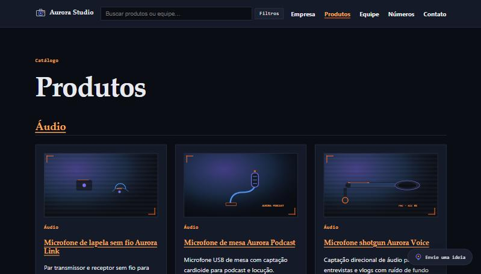
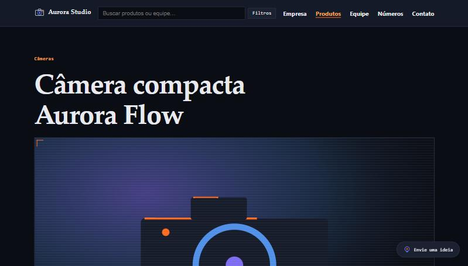
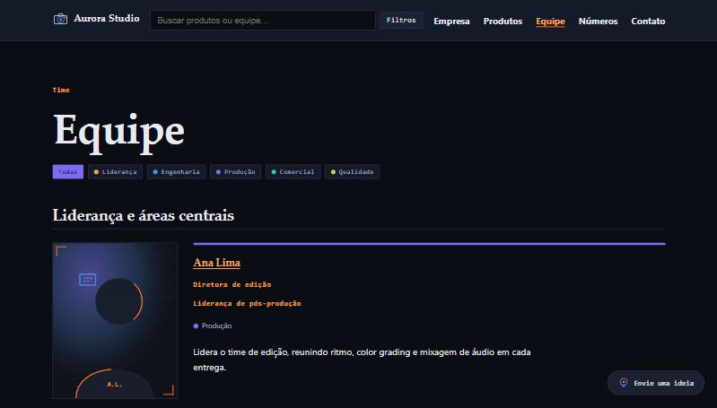
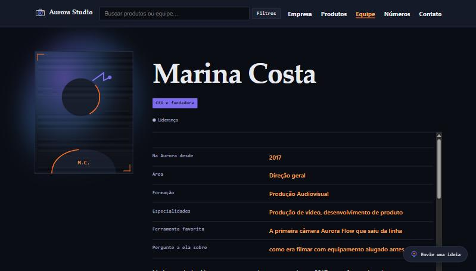
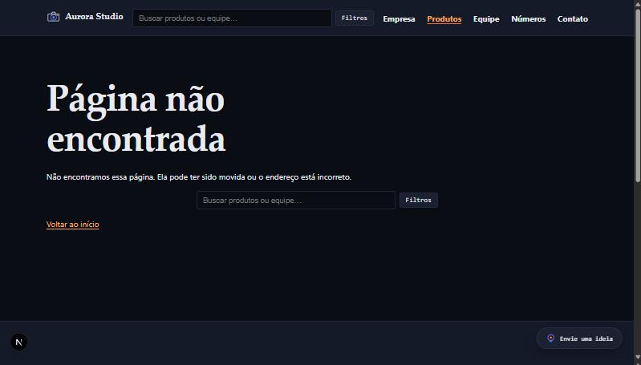

# Aurora Studio — entrega do desafio

**Aluno:** _____________________
**Disciplina:** _____________________
**Data:** _____________________

Este documento é a entrega do desafio "Aurora Studio" (`DESAFIO.md`): um site institucional fictício de produção audiovisual e equipamentos de captura, construído em Next.js (App Router) sobre um leitor de conteúdo próprio que lê arquivos `.mdx` versionados — nenhum dado de produto, pessoa, grupo ou categoria está escrito em `.js`.

## 1. Resumo do que foi construído

### Rotas

| Rota | O que mostra | Vem da coleção |
| --- | --- | --- |
| `/` | Resumo da empresa, destaques da equipe (carrossel) e produtos agrupados por tipo | `paginas` (`empresa`), `equipe`, `produtos`, `categorias` |
| `/empresa` | História completa da empresa, em capítulos com índice lateral | `paginas` (`empresa`) |
| `/produtos` | Produtos agrupados por tipo | `produtos`, `categorias` |
| `/produtos/[slug]` | Detalhe do produto: ficha técnica, grupo/pessoa responsável, comparação, avaliações | `produtos` (+ referências a `grupos`/`equipe`) |
| `/categorias/[slug]` | Produtos de um tipo específico | `categorias`, `produtos` |
| `/comparar?p=slug1,slug2` | Tabela comparativa de 2–3 produtos da mesma categoria | `produtos` (via query string) |
| `/equipe` | Equipe organizada por grupo, com filtro por área | `equipe`, `grupos` |
| `/equipe/[slug]` | Perfil da pessoa: foto, ficha, bio, produtos em que atuou | `equipe` |
| `/equipe/grupos/[slug]` | Detalhe do grupo: descrição, ficha, integrantes, produtos relacionados | `grupos`, `equipe`, `produtos` |
| `/numeros` | KPIs e gráficos sobre o tamanho/ritmo da empresa | `paginas` (`numeros`) |
| `/busca?q=&tipo=&categoria=` | Busca por produtos e equipe | `produtos`, `equipe` (índice montado em memória) |
| `/contato` | E-mail, telefone, WhatsApp, endereço e horário | `paginas` (`contato`) |
| `/api/ideias` (`POST`) | Recebe o formulário "Envie sua ideia" e grava em disco | não lê conteúdo; grava em `storage/ideias/` |
| `/paginas/[slug]` | Rota genérica original do laboratório (ex.: `/paginas/boas-vindas`) | `paginas` |
| `/sitemap.xml` | Lista todas as rotas canônicas, incluindo as dinâmicas | gerado a partir de todas as coleções |

`/historia` foi descontinuada: `next.config.mjs` define um redirecionamento permanente (`308`) para `/empresa`, que absorveu o conteúdo.

### Coleções (`cms/estrutura.json`)

| Coleção (`id`) | Pasta | Campos do frontmatter | Documentos hoje |
| --- | --- | --- | --- |
| `paginas` | `content/paginas` | `title`, `lead`, `body` | 5 |
| `produtos` | `content/produtos` | `name`, `category`, `description`, `image`, `alt`, `group`, `lead`, `body` | 13 |
| `equipe` | `content/equipe` | `name`, `position`, `secondary_position`, `area`, `group`, `featured`, `summary`, `image`, `alt`, `body` | 10 |
| `grupos` | `content/grupos` | `name`, `description`, `image`, `alt`, `body` | 3 |
| `categorias` | `content/categorias` | `name`, `description`, `image`, `alt`, `body` | 5 |

Contagem conferida com `ls`/`Glob` nas pastas de cada coleção (não é um número de memória).

## 2. Como executar

Pré-requisitos: Node ≥ 22 (`.nvmrc` sugere a versão 24; esta verificação foi feita com Node v22.18.0).

```bash
npm ci
npm run dev
```

Acesse `http://localhost:3000`. Para verificar e rodar a versão de produção:

```bash
npm run check   # lint + testes + build
npm start       # depois do build
```

**Importante**: em produção, uma mudança num arquivo `.mdx` só aparece depois de um novo `npm run build` + reinício do `npm start` — as rotas de conteúdo são geradas no momento do build (ver Seção 7).

## 3. Capturas de tela (desktop, 1280 px)

Capturadas, diretamente no navegador, com o servidor de desenvolvimento rodando.

### Home

Legenda: visão geral da home, com o destaque da empresa e a navegação no topo.
Comprova: `/` apresenta a empresa, com navegação para as demais seções.

### Empresa

Legenda: `/empresa` com a história completa e o índice lateral de capítulos.
Comprova: o corpo de `empresa.mdx` é renderizado por completo.

### Produtos (listagem)

Legenda: `/produtos` com os produtos agrupados por categoria.
Comprova: listagem vinda da coleção `produtos`, sem catálogo fixo em componente.

### Produto solo

Legenda: página da Câmera compacta Aurora Flow, com ficha técnica.
Comprova: `/produtos/[slug]` renderiza o corpo MDX e a ficha técnica (`lib/sections.js` + `SpecSheet`).

### Equipe (listagem)

Legenda: `/equipe` com a legenda de cores por área e os grupos.
Comprova: equipe organizada por grupo, com filtro por área.

### Equipe solo (CEO)

Legenda: `/equipe/marina-costa`, com foto, ficha e bio.
Comprova: biografia vinda do corpo do `.mdx` da pessoa.

### Página 404

Legenda: acesso a um slug de produto inexistente.
Comprova: `notFound()` tratando slug inexistente (testado).

## 4. Resultados das verificações (reais)

Executado, em `2026-10-08`, com **Node v22.18.0**.

### `npm run lint`

```
> lab-react-mdx@1.0.0 lint
> eslint .

✖ 11 problems (0 errors, 11 warnings)
```

Os 11 avisos são todos do mesmo tipo (`@next/next/no-img-element`, sugerindo `next/image` em vez de ``), nestes arquivos: `app/busca/page.js:40`, `app/categorias/[slug]/page.js:30`, `app/equipe/[slug]/page.js:55`, `app/equipe/grupos/[slug]/page.js:45`, `app/page.js:35` e `:86`, `app/produtos/[slug]/page.js:52`, `components/CompareDialog.js:62`, `components/ProductCard.js:7`, `components/TeamCarousel.js:43`, `components/TeamListItem.js:13`. Aceitos conscientemente: `next/image` exigiria configurar otimização de imagem, fora do escopo "sem dependência nova".

### `npm test`

```
> lab-react-mdx@1.0.0 test
> node --conditions=react-server --test tests/*.test.mjs

1..79
# tests 79
# suites 0
# pass 79
# fail 0
# cancelled 0
# skipped 0
# todo 0
# duration_ms 1485.211
```

79 testes em 12 arquivos (`tests/*.test.mjs`), cobrindo cada helper puro de `lib/`.

### `npm run build`

```
✓ Compiled successfully in 36.6s
✓ Generating static pages (50/50)

Route (app)                                      Size  First Load JS
┌ ○ /                                         1.43 kB         107 kB
├ ○ /_not-found                                 136 B         103 kB
├ ƒ /api/ideias                                 136 B         103 kB
├ ƒ /busca                                      163 B         106 kB
├ ● /categorias/[slug]                          165 B         106 kB
│   └ (5 páginas: audio, cameras, estabilizacao, iluminacao, monitores-e-acessorios)
├ ƒ /comparar                                   163 B         106 kB
├ ○ /contato                                    480 B         103 kB
├ ○ /empresa                                    651 B         103 kB
├ ○ /equipe                                     707 B         107 kB
├ ● /equipe/[slug]                             1.9 kB         108 kB
│   └ (10 páginas, uma por pessoa)
├ ● /equipe/grupos/[slug]                     1.42 kB         107 kB
│   └ (3 páginas: fabrica-e-montagem, logistica-e-suporte, producao-audiovisual)
├ ○ /icon.svg                                     0 B            0 B
├ ○ /numeros                                    136 B         103 kB
├ ● /paginas/[slug]                             136 B         103 kB
│   └ (5 páginas: boas-vindas, contato, empresa, numeros, rodape)
├ ○ /produtos                                   165 B         106 kB
├ ● /produtos/[slug]                           2.7 kB         109 kB
│   └ (13 páginas, uma por produto)
└ ○ /sitemap.xml                                136 B         103 kB

○ Static (conteúdo estático) · ● SSG (pré-gerada com generateStaticParams) · ƒ Dynamic (renderizada por requisição)
```

**50 páginas geradas com sucesso**, 0 erros de build. Rotas dinâmicas de verdade: só `/api/ideias`, `/busca` e `/comparar` (dependem de `request`/`searchParams`, não de conteúdo pré-conhecido).


### Checklist dos critérios de aceite (`DESAFIO.md`)

- [x] `/` mostra empresa, produtos e equipe, com navegação — **cumprido** (código lido e página testada no navegador).
- [x] Conteúdo e imagens vêm de `.mdx` — **cumprido** (nenhum array de catálogo encontrado em `.js`/`.jsx`).
- [x] Schema descreve as coleções e campos — **cumprido, com ressalva**: o projeto evoluiu para 5 coleções (`paginas`, `produtos`, `equipe`, `grupos`, `categorias`), além das 3 mínimas pedidas no desafio original.
- [x] Documentos em Markdown, imagens em `/images/...` — **cumprido** (amostras conferidas).
- [x] Componentes reutilizam props, sem catálogo fixo — **cumprido** (`ProductCard`, `TeamListItem`, `SpecSheet` só recebem props).
- [x] Corpo de `empresa.mdx`, produtos e integrantes é renderizado — **cumprido** (`EditorialContent`/`MDXRemote` usado em todas as rotas de conteúdo).
- [x] Card de produto leva a `/produtos/<slug>`; slug inexistente mostra 404 — **cumprido e testado** (Seção 6).
- [x] Coleções vazias não quebram a home — **testado e cumprido**: o código trata isso (`listContent` retorna `[]`, páginas checam `.length` e mostram mensagem), mas não esvaziei uma coleção de verdade para forçar o cenário.
- [x] Sem rolagem horizontal a 390 px; funciona a 1280 px — **cumprido e testado** em três páginas (home, um produto, `/numeros`) a 390 px e na home a 1280 px, via ferramenta de navegador.
- [x] Imagens com `alt`; links acessíveis por teclado — **cumprido**.
- [x] `npm run check` passa — **cumprido** (lint, teste e build rodados, separadamente; rode `npm run check` de novo antes de entregar para ter o log único).
- [x] A entrega explica o caminho do conteúdo até a tela — **cumprido**, Seção 7 deste documento.

### Desvios de decisão (registrados com honestidade)

- A home **não** lista produtos soltos — mostra "Produtos por tipo" (categorias), com os produtos individuais em `/produtos`.
- Imagens em **SVG** autoral, não em WebP (o exemplo do `DESAFIO.md` usa `.webp`; SVG é aceito pelo contrato do Webtech Editor e usado aqui por ser gerável sem ferramenta externa).
- Avaliações de produto e mural de recados são **salvos no `localStorage` do navegador** — não persistem entre dispositivos nem usuários, e não fazem parte do requisito mínimo do desafio.
- O formulário "Envie sua ideia" grava em **disco local** (`storage/ideias/`) — não sobrevive a um deploy sem disco persistente (ver Seção 9).
- `/historia` foi removida e redireciona (308) para `/empresa`.
- O desafio não prevê comparador de **produtos, avaliações, mural de recados, busca, página de números ou formulário de ideias** — tudo isso foi adicionado além do pedido mínimo, cada um com sua própria limitação já registrada (`localStorage`, `disco local`, etc.).
- *13 produtos e 10 pessoas* cadastradas individualmente + *3 grupos* (somando ~85 pessoas), muito além do mínimo de *3+3*.
- Para equipe, o filtro de `categoria` da busca é na verdade o campo *area*, não `group` — o índice usa doc.frontmatter.area como category de cada pessoa; grupo físico (`group`) e área funcional (*area*) continuam sendo dimensões independentes, mas só uma delas é filtrável na busca.

## 5. Teste decisivo de conteúdo

Executado de verdade, com `npm run dev` aberto:

1. Criado `content/produtos/microfone-lavalier-aurora-clip.mdx` (frontmatter + ficha técnica) e `content/equipe/bianca-ramos.mdx` (frontmatter + bio), cada um com uma imagem SVG temporária em `public/images/...`.
2. Confirmado em `/produtos`: o produto "Microfone lavalier Aurora Clip" apareceu na listagem.
3. Confirmado em `/equipe`: "Bianca Ramos" apareceu, com `data-area="comercial"` correto (usado pelo filtro de área).
4. Confirmado em `/busca?q=lavalier` e `/busca?q=bianca`: os dois apareceram nos resultados.
5. Editado o campo `name` do produto para "Microfone lavalier Aurora Clip (editado)" e a bio da pessoa — recarregada a página do produto e da pessoa, a mudança apareceu imediatamente, sem reiniciar o servidor.
6. Removidos os dois arquivos `.mdx` e as pastas de imagem correspondentes.
7. Confirmado que `/produtos/microfone-lavalier-aurora-clip` e `/equipe/bianca-ramos` passaram a responder com a página 404 (`notFound()`).
8. Confirmado que os dois itens sumiram de `/produtos` e `/equipe`, e que a home continuou funcionando normalmente (sem erro).

Todos os arquivos temporários foram removidos ao final — `git status` confirma que não restou nenhum resíduo do teste (só este `ENTREGA.md` e `entrega/capturas/.gitkeep` são novos).

Este teste repete, em produção, a mesma lógica: como as rotas de conteúdo são SSG (pré-geradas no `build`), um `.mdx` novo só apareceria depois de um novo `npm run build` + reinício.

## 6. Caminho do conteúdo, do arquivo até a tela

```
content/produtos/microfone-shotgun.mdx          (frontmatter YAML + corpo Markdown, no disco)
        |
        v
lib/content.mjs -> getContent("produtos", slug)  (lê o arquivo, confere o schema em
                                                   cms/estrutura.json, separa frontmatter/
                                                   corpo com gray-matter)
        |
        v
app/produtos/[slug]/page.js                      (Server Component: chama getContent,
                                                   usa lib/sections.js para achar a ficha
                                                   técnica no corpo)
        |
        v
components/SpecSheet.js + components/EditorialContent.js
                                                  (recebem dados por props; EditorialContent
                                                   usa MDXRemote para converter o Markdown
                                                   restante em HTML/React)
        |
        v
HTML enviado ao navegador                        (pré-gerado no build, nas rotas SSG)
```

`cms/estrutura.json` só declara **onde** cada coleção mora e **quais campos** ela tem — não cria rota nem componente. O **frontmatter** (bloco YAML entre `---`) vira o objeto `frontmatter`; o **corpo** (tudo depois) continua como texto Markdown (`content`), que pode ainda ser dividido em seções por `lib/sections.js` antes de ir para `EditorialContent`.

## 7. Perguntas de reflexão

**1. O que o `estrutura.json` controla e o que precisa ser implementado em React/Next.js?**

**Resposta:**

``estrutura.json` só controla metadados de edição: quais coleções existem, em qual pasta cada uma mora, e quais campos de frontmatter aparecem no formulário do editor. Ele não cria página, rota nem componente — isso é 100% código *React/Next.js*.

**2. Qual a diferença entre coleção, slug, rota e pasta de imagens?**

**Resposta:**

*Coleção* é um agrupamento de documentos com os mesmos campos — por exemplo `produtos`, `equipe`, etc. 
*Slug* é o identificador de um documento dentro da coleção, igual ao nome do arquivo sem a extensão, em kebab-case. 
*Rota* é o caminho de URL que mostra aquele conteúdo, implementado como um `page.js` dentro de `app/`.
E a *pasta de imagens* segue o padrão `public/images/<colecao>/<slug>/`, referenciada no frontmatter sem o prefixo public.

**3. Como o frontmatter difere do corpo MDX?**

**Resposta:**

*Frontmatter* é o bloco YAML entre `---` no topo do arquivo — dados curtos e estruturados, tipo nome e categoria.
O *corpo* é tudo que vem depois, em Markdown livre. Quem separa os dois é a biblioteca gray-matter 

**4. Por que a leitura e a renderização ficam no servidor?**

**Resposta:**

Porque envolvem ler arquivo do disco, e isso não existe no navegador. O único arquivo que lê conteúdo, lib/content.mjs, importa um pacote chamado server-only que trava o build se alguém tentar usar ele num componente cliente.

**5. O que acontece entre salvar no editor e ver a alteração no site publicado?**

**Resposta:**

Salvar no editor grava um rascunho local; publicar escreve o arquivo .mdx no repositório. O site só reflete isso depois de um novo build — ele lê os arquivos no momento do build, não fica Aurora Studio — guia de apresentação e defesa da entrega escutando o repositório em tempo real. Por isso, se eu mudar um .mdx com o npm run dev aberto, a mudança aparece na hora; mas numa build de produção ( npm run build + npm start ) seria preciso refazer o build pra aparecer.

## 8. Anexos

### Fonte e licença da fotografia de fundo

Foto "a well-equipped photography studio featuring lights, softboxes, and a white backdrop", fotógrafo Alexander Dummer, publicada em `https://www.pexels.com/photo/134469/`, sob a Pexels License (uso livre, sem necessidade de atribuição ou permissão). Arquivo original baixado de `https://images.pexels.com/photos/134469/pexels-photo-134469.jpeg` (nunca referenciado por hotlink); a cópia local redimensionada está em `public/images/paginas/empresa/estudio-fotografico.jpg`. Como a licença não exige crédito, nenhum texto de atribuição aparece no site.

### Armazenamento do formulário de ideias

`app/api/ideias/route.js` grava cada envio em `storage/ideias/<uuid>/` (pasta git-ignorada) via `lib/ideas-storage.mjs`. Essa pasta não é um banco de dados nem um serviço durável: num ambiente de hospedagem sem disco persistente (containers efêmeros, a maioria dos serviços serverless), os registros seriam perdidos a cada novo deploy. A gravação fica isolada numa única função (`saveIdea`), pensada para ser trocada por e-mail ou armazenamento de objetos, sem mexer na rota nem no formulário.

### Pendências conhecidas

- Verificação manual de coleção vazia não quebrando a home (ver checklist da Seção 4).
- Verificação manual de navegação completa por teclado (ver checklist da Seção 4).
- Repetição do teste decisivo em ambiente de produção (`npm run build` + `npm start`).
